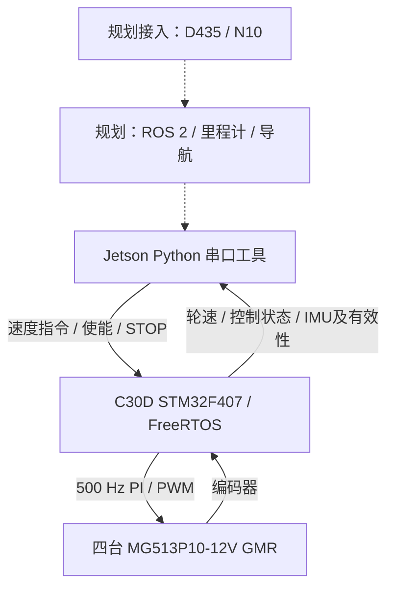
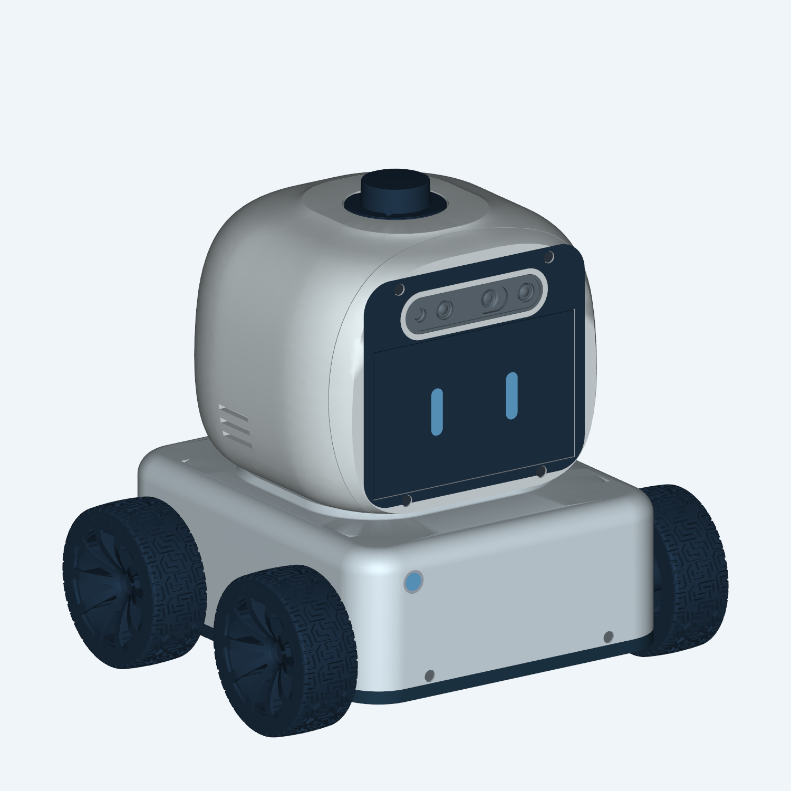
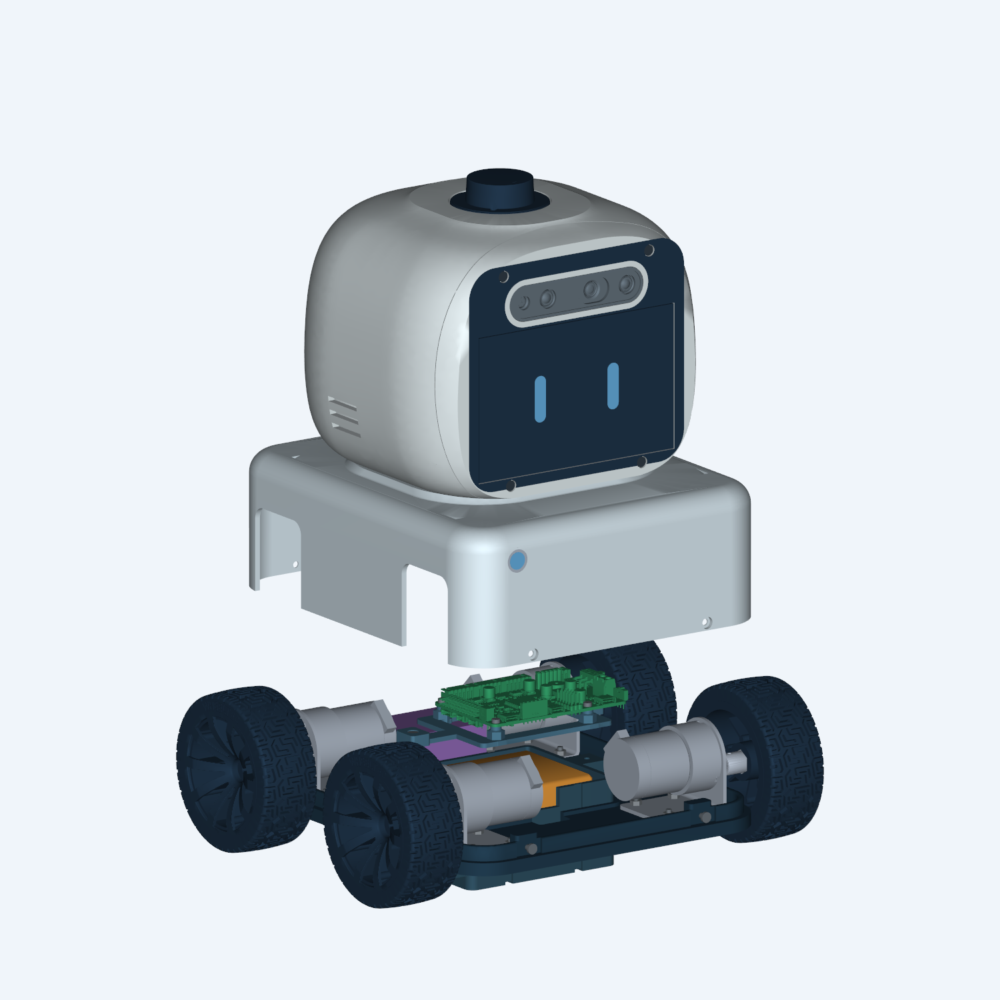

# NavBot

NavBot 是一个以自主导航为目标的机器人项目，覆盖机械结构、嵌入式控制与上位机软件。当前以四台直流电机、轮趣 C30D（STM32F407）和 Jetson Orin Nano 构建底盘运动链路，通过自定义串口协议连接上下位机；RealSense D435、N10 激光雷达及 ROS 2 导航属于后续整机集成范围。

**当前阶段（2026-11-08）：** 底盘已组装并接入四台电机，主仓库锁定 `navbot_body` 固件 **1.1.2**。已完成 C++ 电机模块、串口速度闭环、编码器反馈、Jetson Python 工具及架空实测；尚未完成落地负载标定和 ROS 导航集成。IMU 有报文输出，但存在间歇无效及姿态未就绪问题，不能视为已通过验收。

## 当前功能

| 模块 | 已实现与验证 | 边界 |
| --- | --- | --- |
| 电机 | C++17 电机抽象及四轮派生对象；方向、停止、编码器已实测 | C左前、D左后、B右前、A右后 |
| 速度控制 | 500 Hz 四轮 PI、前馈与有界起转补偿；支持独立轮速及车体 vx/wz | PWM ≤20%；参数按架空短测整定 |
| 通信 | USART3 USB，460800/8N1，CRC/会话/序号校验；轮速和控制状态100 Hz | 时间单位µs、分辨率1ms；未完成ROS时间映射 |
| Jetson | Python串口收发、模拟速度回调、记录与指标分析 | 未实现正式ROS节点、里程计、TF/EKF |
| 停机 | STOP、命令超时、起转超时、重复低速故障锁定、IWDG | 软件撤销PWM不等于硬件断能或机械瞬停 |
| IMU | 原始惯性数据100 Hz、姿态四元数50 Hz及有效性/健康诊断 | 当前实机有效性异常；安装坐标变换未完成 |
| 感知与导航 | D435、N10、ROS 2 为整机目标配置 | 驱动集成、建图、定位和导航未交付 |



最新架空回归：±0.6 rad/s转向反馈约+0.617/−0.610 rad/s；后轮起转70～125ms，轮速波动较同场旧版下降26%～31%，仍有残余波动。六次最终运动测试通过停止与超时检查，串口无解析错误/丢帧。该结果是编码器与名义几何换算，不代表落地车体速度已经标定。

详见[通信与使用](docs/jetson-c30d-protocol.md)、[硬件与参数](docs/c30d-hardware-analysis.md)、[最新实测报告](deps/navbot_body/validation/rear-low-speed.txt)。

## 硬件设计

当前硬件归档为 [1.2.0](hardware/releases/1.2.0/README.md)，对应 **V16.5**，归档日期为 **2026-10-27**。下载 [NavBot-Hardware-1.2.0.zip](hardware/releases/1.2.0/NavBot-Hardware-1.2.0.zip)，按 [SHA-256 清单](hardware/releases/1.2.0/SHA256SUMS.txt)核验文件完整性。





本版采用四电机上置布局、方案A底盘止口与侧向M3锁紧连接；头部集成屏幕、D435、Jetson与下沉式雷达。包含9件打印零件，覆盖底板、底盘上盖、充电接口嵌件及压盖、C30D托架、头部前后壳、Jetson托盘和中央电池仓。

解压后从 `design-v16.5/版本归档说明-1.2.0.md` 开始：

| 用途 | 归档内路径（相对 `design-v16.5/`） |
| --- | --- |
| FreeCAD装配工程 | `NavBot-V16.5.FCStd` |
| 打印交付包 | `NavBot-V16.5-Print-Pack/` 及同名ZIP |
| 打印零件 | `NavBot-V16.5-Print-Pack/STL/`、`STEP/` |
| 零件、紧固件及装配说明 | 打印交付包内的CSV清单与《设计与装配说明.txt》 |
| 外观、组合爆炸图、拆解与连接细节 | `参考图/` |
| 设计参数、校核报告和整理记录 | 根目录JSON及打印交付包内报告 |
| 重建、修整、导出及校核工具 | `tools/`，先阅读《使用说明.txt》 |

主工程包含零件实体，可直接打开；主要保存已生成几何，不是完整可回放的参数化特征历史。`prototype-stl/` 保留装配坐标，打印交付包内的STL已按打印用途调整坐标。归档保留必要过程文件与对比图，删除可重新生成的渲染缓存及自动备份。

历史版本关系：1.0.0对应V13；V14、V15为中间工程基准，V16.5对应本次1.2.0归档。完整脚本重建依赖本地V15基准工程、校核数据和V16紧固件清单，历史基准不在1.2.0中重复打包。厂家STEP模型、图纸和采购资料在本地 `hardware/components/` 保留原名。

历史归档记录的是归档当时的验证范围。当前底盘已组装并完成架空电机测试，但整机线缆配合、长期强度、温升与自主导航尚未完成验收。硬件1.2.0表示机械结构留档，不表示整机验收；占位件、打印配合及验证边界以归档内装配说明和校核报告为准。

## 仓库结构

```text
NavBot/
├── README.md                    # 项目现状与硬件/软件入口
├── hardware/
│   ├── releases/1.2.0/          # Git跟踪：归档、说明、校验值和预览图
│   ├── designs/                 # 仅本地：工作设计与历史重建基准
│   └── components/              # 仅本地：厂家模型、图纸和采购资料
├── src/                         # 预留：ROS 2 软件
├── docs/                        # 当前功能、接口、参数与验证计划
├── deps/navbot_body/             # Git submodule：C30D固件
└── release/                     # 预留：系统发布产物
```

`hardware/` 仅允许 `releases/` 纳入Git；工作设计及组件资料保留在本地。`src/` 和根目录 `release/` 为预留目录，Git不跟踪空目录。STM32工程的使用和验证范围见子模块锁定版本的[工程说明](deps/navbot_body/README.md)。

## 查看与使用

首次克隆时一并拉取固件子模块：

```sh
git clone --recurse-submodules https://github.com/Stella-CN/NavBot.git
```

已有仓库在拉取主仓库更新后，使用 `git submodule update --init --recursive` 检出主仓库锁定的固件提交。固件独立仓库为 [navbot_body](https://github.com/Stella-CN/navbot_body)；`.gitmodules` 的 `branch = main` 用于显式更新远端子模块，普通初始化仍遵循主仓库记录的提交。

1. 下载并校验硬件1.2.0归档，解压后阅读 `版本归档说明-1.2.0.md` 和 `工程说明.txt`。
2. 使用FreeCAD打开 `NavBot-V16.5.FCStd` 查看装配。
3. 打印前阅读交付包内《设计与装配说明.txt》，确认材料、打印方向、支撑、连接件规格及试配要求。
4. 如需重新生成文件，按 `tools/使用说明.txt` 的顺序执行。FreeCAD相关脚本依赖本机FreeCAD Python环境，渲染和排版依赖VTK/Pillow；完整重建还需准备前述历史基准。

单独重新导出STL/STEP不等于重新验证设计。结构变更后需重新检查孔位、干涉和拆装空间，并更新校核报告与图示。

固件使用 STM32 HAL/FreeRTOS、C++17应用层和 C BSP，CMake + Arm GCC 构建，OpenOCD/CMSIS-DAP 下载；Debug/Release编译和实机烧录已验证。软件检查不驱动电机：

```sh
bash deps/navbot_body/scripts/check.sh
bash deps/navbot_body/scripts/test-motion.sh
bash deps/navbot_body/scripts/build.sh Debug
```

Jetson采集与架空运动工具用法见[通信与使用](docs/jetson-c30d-protocol.md)。主仓库管理子模块版本和整机文档；固件实现、测试及精确协议由子仓库维护。

## 当前问题与下一步

- 优先排查IMU总线错误、数据间歇无效和姿态校准未完成；接收端不得使用无效帧参与融合。
- 确认残余卡顿声与振动，标定每轮实际计数、承载轮径及有效轮距，再做落地低速验证。
- 核对Jetson实际系统/驱动版本，实现单进程串口ROS适配、时间映射、里程计和安装坐标变换。
- 完成供电、电流/欠压诊断需求、硬件断能路径与停车距离验证，再开展感知和导航联调。

验收顺序见[实施与验证计划](docs/implementation-plan.md)。

## 参考资料

- [NVIDIA Jetson Orin Nano 开发套件用户指南](https://docs.nvidia.com/jetson/orin-nano-devkit/user-guide/latest/)
- [RealSense D435 官方介绍](https://www.realsenseai.com/products/stereo-depth-camera-d435/)

外部资料用于理解组件；项目实际配置与完成状态以本仓库工程文件、协议文档及实机验证记录为准。
