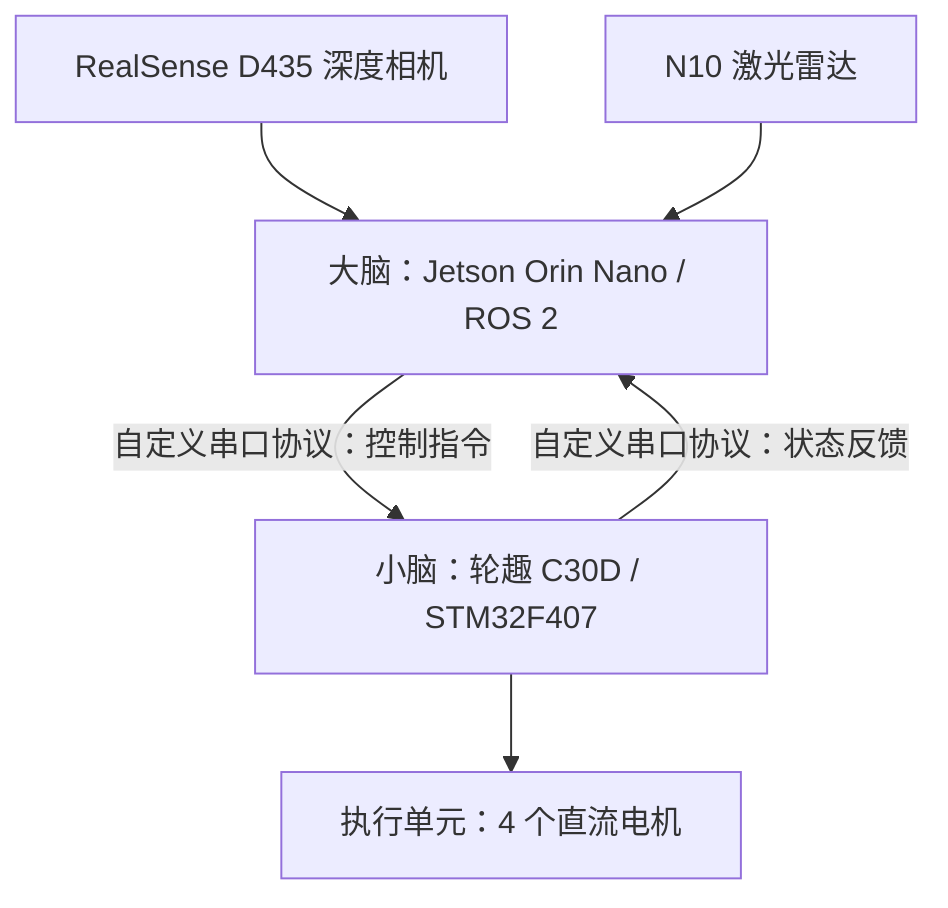
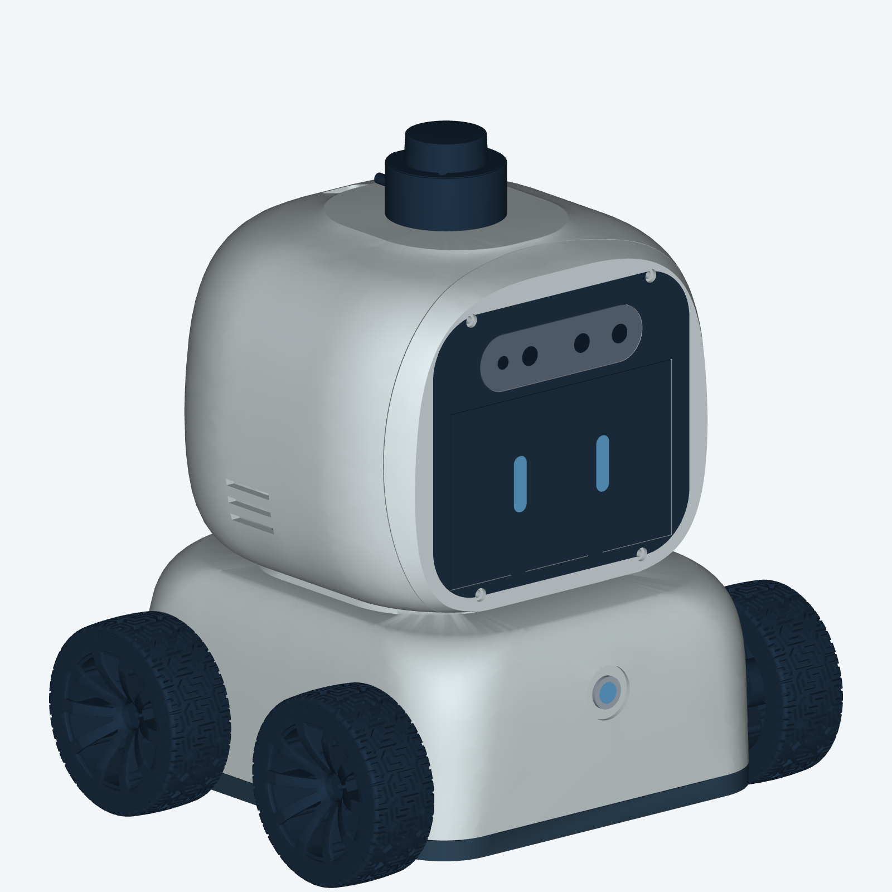
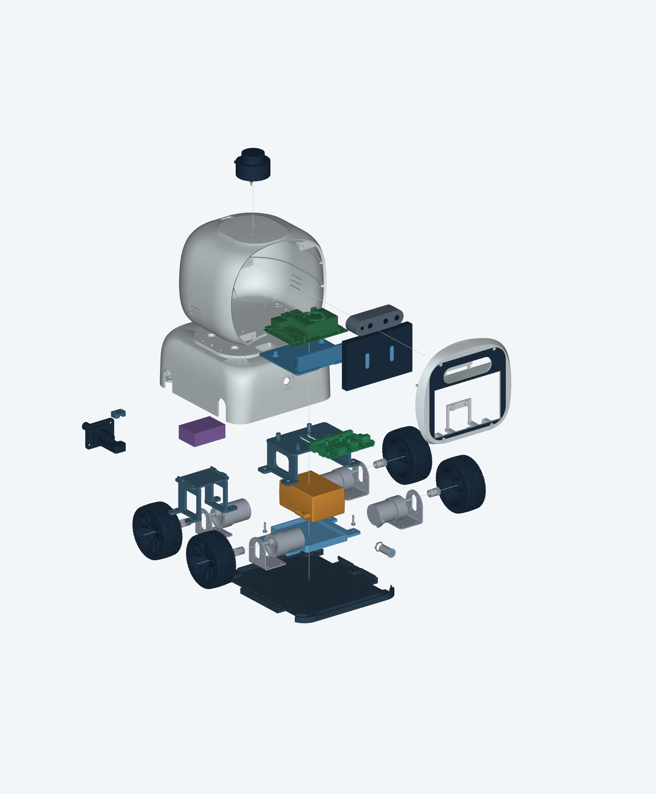

# NavBot

NavBot 是一个自主设计的全栈（硬件 + 软件）自主导航机器人项目，涵盖机械结构、嵌入式控制、传感器接入与 ROS 2 导航系统。机器人采用 4 个直流电机作为执行单元，以轮趣 C30D（STM32F407）作为“小脑”、Jetson Orin Nano 作为“大脑”，通过自定义串口协议连接上下位机，使用 RealSense D435 深度相机和 N10 激光雷达感知环境。

**当前阶段：** 仓库已保存 V13 机械设计基准、采购件参考资料和打印交付包；ROS 2 软件、STM32 固件及串口协议实现尚未纳入仓库。下述软件职责描述为目标架构，不代表功能已经完成或通过实机验证。

## 系统架构



| 层级 | 硬件 / 技术栈 | 目标职责 |
| --- | --- | --- |
| 感知 | D435 + N10 | 提供深度视觉与激光扫描数据，为环境感知、定位与避障提供输入 |
| 高层计算 | Jetson Orin Nano + ROS 2 | 传感器接入、建图定位、路径规划、导航决策及底盘控制指令生成 |
| 实时控制 | 轮趣 C30D / STM32F407 | 执行电机控制、处理上位机指令并回传底层状态 |
| 执行 | 4 个直流电机 | 驱动移动底盘 |
| 通信 | 自定义串口协议 | 承载上下位机控制指令与状态反馈 |
| 机械结构 | FreeCAD 工程、STL / STEP | 组织底盘、头壳、计算与控制板卡、传感器和供电组件的安装 |

上下位机通信的帧格式、波特率、数据字段、单位、校验方式及超时处理规则尚未在仓库中定义。ROS 2 发行版、JetPack 版本、具体导航组件及底盘运动学模型也需在软件接入时明确。

## 硬件设计

当前唯一设计基准为 [`hardware/design-v13/NavBot-V13.FCStd`](hardware/design-v13/NavBot-V13.FCStd)，冻结日期为 **2026-10-19**。





V13 包含 10 个打印件，覆盖承重底板、整体罩壳、头部前后壳、C30D 安装台、Jetson 可拆托盘、电池托架、升压模块框架及充电接口相关结构。对象名、编号和文件映射见[打印件清单](hardware/design-v13/打印件清单.csv)。

- **装配工程：** FreeCAD 文件内含零件实体，主要保存已生成几何，不是完整可回放的参数化特征历史。
- **原型 STL：** `prototype-stl/` 保留装配坐标。
- **打印交付包：** `NavBot-V13-Print-Pack/` 提供居中落地的 STL / STEP、零件和紧固件清单、PETG 打印说明、装配说明、参考图及既有校核报告；同名 ZIP 为便携副本。
- **采购件资料：** `hardware/` 根目录保留厂家模型、图纸及压缩包，包含备选器件，不等同于当前装配配置。

现有设计冻结和几何校核不表示实物装配、长期强度测试或自主导航验证已经完成。采购件拓扑及包络模型的限制见[设计与装配说明](hardware/design-v13/NavBot-V13-Print-Pack/设计与装配说明.txt)。

## 仓库结构

```text
NavBot/
├── README.md                    # 项目介绍
├── 项目说明.txt                  # 硬件工程入口
├── hardware/                    # 采购件模型、图纸与硬件设计
│   └── design-v13/               # 当前机械设计基准
│       ├── NavBot-V13.FCStd
│       ├── prototype-stl/        # 保留装配坐标的打印件
│       ├── NavBot-V13-Print-Pack/ # 打印交付文件与校核报告
│       ├── NavBot-V13-Print-Pack.zip
│       ├── 打印件清单.csv
│       └── tools/                # 导出、验证与打包脚本
├── src/                         # 预留：ROS 2 软件及嵌入式固件
├── docs/                        # 预留：架构、通信协议与调试文档
├── deps/                        # 预留：项目依赖资料
└── release/                     # 预留：系统发布产物
```

`src/`、`docs/`、`deps/` 和 `release/` 当前为空；Git 不跟踪空目录，克隆后可按需创建。

## 查看与使用

1. 阅读 [V13 工程说明](hardware/design-v13/工程说明.txt)，了解设计基准和文件用途。
2. 使用 FreeCAD 打开 `NavBot-V13.FCStd` 查看装配。
3. 打印前阅读[设计与装配说明](hardware/design-v13/NavBot-V13-Print-Pack/设计与装配说明.txt)和 [FDM 打印说明](hardware/design-v13/NavBot-V13-Print-Pack/FDM打印说明.txt)，按交付包清单选取文件。
4. 如需重新导出，按工程说明运行 `tools/export_print_pack.py`、`tools/verify_release.py` 和 `tools/package_release.py`。前两个脚本依赖 FreeCAD Python 环境；工程说明中的路径为 macOS 示例，需按实际安装位置调整。

导出工具只更新 STL / STEP 和导出清单，不重建设计、不自动重算干涉或刷新参考图。结构变更后需重新检查孔位、干涉和拆装空间，并更新对应报告与图示。

当前没有可执行的 ROS 2 构建、启动或固件烧录流程，待源码和环境配置加入后补充。

## 后续开发

- 明确 JetPack / ROS 2 版本及 D435、N10 的驱动和标定配置。
- 定义串口协议及异常处理机制，实现 ROS 2 与 STM32 两端通信。
- 接入电机控制和实际可用的底盘反馈，验证运动学与里程计。
- 集成建图、定位、路径规划和避障，记录实机测试结果。
- 完成机械装配、供电与持续运行验证，完善部署和调试文档。

## 参考资料

- [NVIDIA Jetson Orin Nano 开发套件用户指南](https://docs.nvidia.com/jetson/orin-nano-devkit/user-guide/latest/)
- [RealSense D435 官方介绍](https://www.realsenseai.com/products/stereo-depth-camera-d435/)

外部资料用于理解组件；项目实际配置与完成状态以本仓库工程文件、协议文档及实机验证记录为准。
