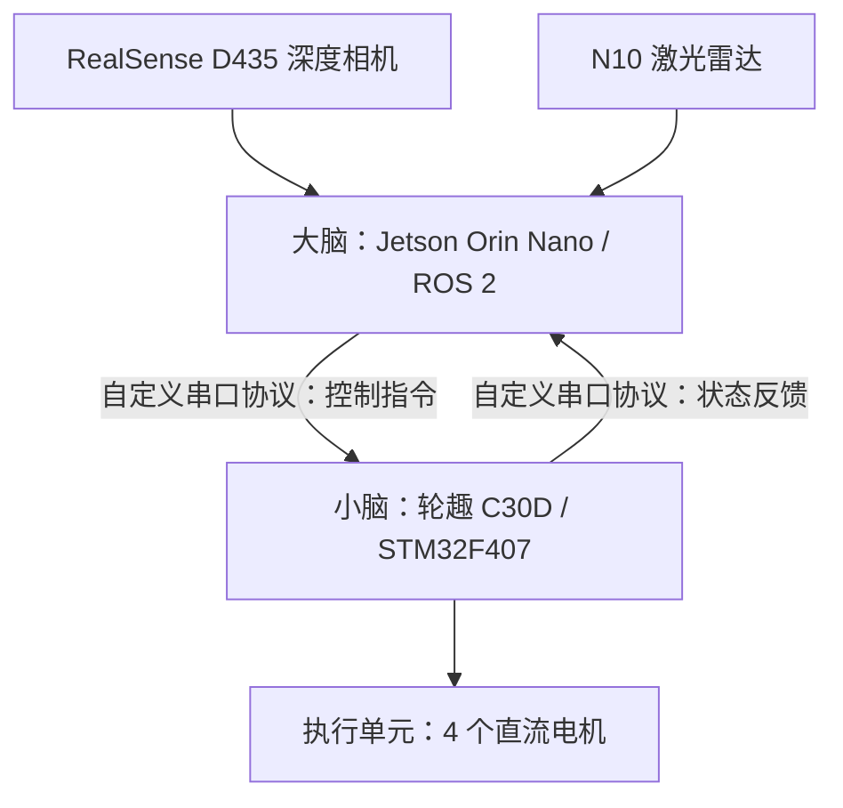
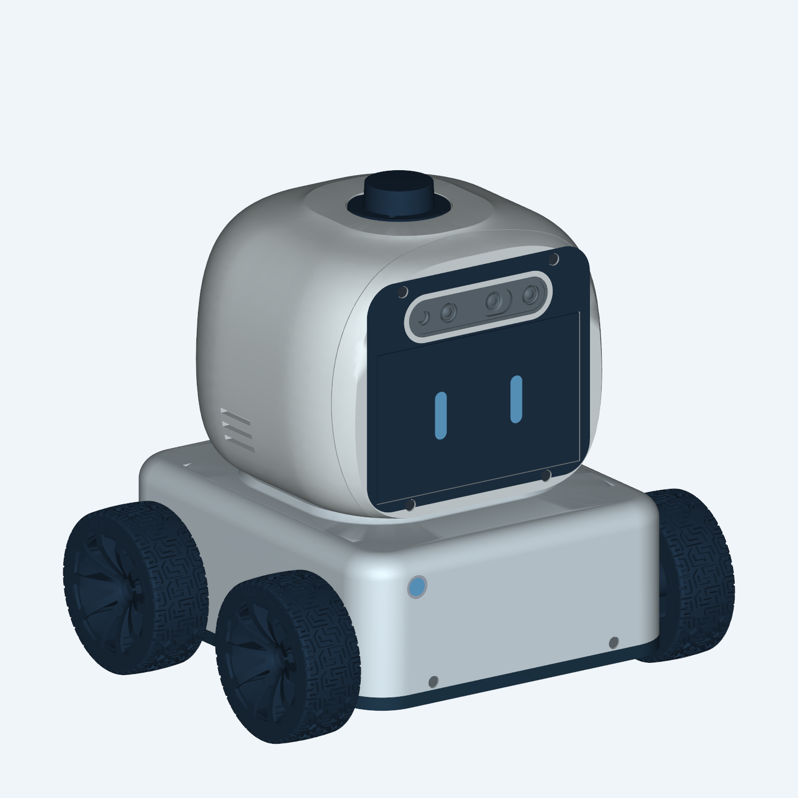
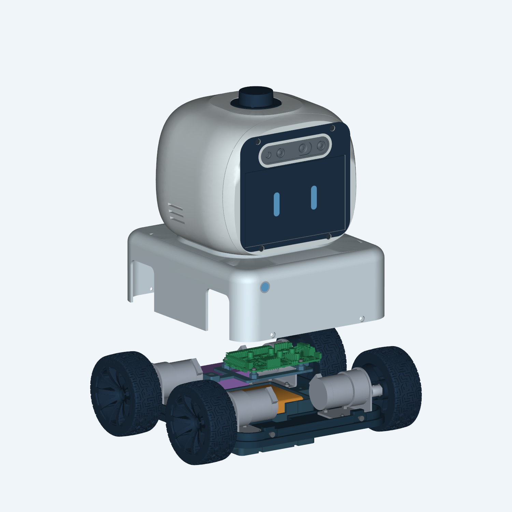

# NavBot

NavBot 是一个自主设计的全栈（硬件 + 软件）自主导航机器人项目，涵盖机械结构、嵌入式控制、传感器接入与 ROS 2 导航系统。机器人采用 4 个直流电机作为执行单元，以轮趣 C30D（STM32F407）作为“小脑”、Jetson Orin Nano 作为“大脑”，通过自定义串口协议连接上下位机，使用 RealSense D435 深度相机和 N10 激光雷达感知环境。

**当前阶段：** V16.5 机械结构已整理为硬件 1.2.0 归档，保留装配工程、9件打印零件及校核记录。主仓库锁定版本在 `deps/navbot_body/` 加入 STM32 HAL + FreeRTOS 工程模板及静态验证。ROS 2 软件、电机闭环及串口协议尚未实现；模板未编译、下载或实机验证。下述软件职责描述为目标架构。

## 系统架构



| 层级 | 硬件 / 技术栈 | 目标职责 |
| --- | --- | --- |
| 感知 | D435 + N10 | 提供深度视觉与激光扫描数据，为环境感知、定位与避障提供输入 |
| 高层计算 | Jetson Orin Nano + ROS 2 | 传感器接入、建图定位、路径规划、导航决策及底盘控制指令生成 |
| 实时控制 | 轮趣 C30D / STM32F407 | 执行电机控制、处理上位机指令并回传底层状态 |
| 执行 | 4 个直流电机 | 驱动移动底盘 |
| 通信 | 自定义串口协议 | 承载上下位机控制指令与状态反馈 |
| 机械结构 | FreeCAD 工程、STL / STEP | 组织底盘、头壳、计算与控制板卡、传感器和供电组件的安装 |

上下位机通信的帧格式、波特率、数据字段、单位、校验方式及超时处理规则尚未在仓库中定义。ROS 2 发行版、JetPack 版本、具体导航组件及底盘运动学模型也需在软件接入时明确。

## 硬件设计

当前硬件归档为 [1.2.0](hardware/releases/1.2.0/README.md)，对应 **V16.5**，归档日期为 **2026-10-27**。下载 [NavBot-Hardware-1.2.0.zip](hardware/releases/1.2.0/NavBot-Hardware-1.2.0.zip)，按 [SHA-256 清单](hardware/releases/1.2.0/SHA256SUMS.txt)核验文件完整性。





本版采用四电机上置布局、方案A底盘止口与侧向M3锁紧连接；头部集成屏幕、D435、Jetson与下沉式雷达。包含9件打印零件，覆盖底板、底盘上盖、充电接口嵌件及压盖、C30D托架、头部前后壳、Jetson托盘和中央电池仓。

解压后从 `design-v16.5/版本归档说明-1.2.0.md` 开始：

| 用途 | 归档内路径（相对 `design-v16.5/`） |
| --- | --- |
| FreeCAD装配工程 | `NavBot-V16.5.FCStd` |
| 打印交付包 | `NavBot-V16.5-Print-Pack/` 及同名ZIP |
| 打印零件 | `NavBot-V16.5-Print-Pack/STL/`、`STEP/` |
| 零件、紧固件及装配说明 | 打印交付包内的CSV清单与《设计与装配说明.txt》 |
| 外观、组合爆炸图、拆解与连接细节 | `参考图/` |
| 设计参数、校核报告和整理记录 | 根目录JSON及打印交付包内报告 |
| 重建、修整、导出及校核工具 | `tools/`，先阅读《使用说明.txt》 |

主工程包含零件实体，可直接打开；主要保存已生成几何，不是完整可回放的参数化特征历史。`prototype-stl/` 保留装配坐标，打印交付包内的STL已按打印用途调整坐标。归档保留必要过程文件与对比图，删除可重新生成的渲染缓存及自动备份。

历史版本关系：1.0.0对应V13；V14、V15为中间工程基准，V16.5对应本次1.2.0归档。完整脚本重建依赖本地V15基准工程、校核数据和V16紧固件清单，历史基准不在1.2.0中重复打包。厂家STEP模型、图纸和采购资料在本地 `hardware/components/` 保留原名。

V15试装版及后续结构归档均未完成实物装配、线缆配合、长期强度、温升或自主导航验证。1.2.0表示机械结构留档，不表示整机验收；占位件、打印配合及验证边界以归档内装配说明和校核报告为准。

## 仓库结构

```text
NavBot/
├── README.md                    # 项目说明与硬件工程入口
├── hardware/
│   ├── releases/1.2.0/          # Git跟踪：归档、说明、校验值和预览图
│   ├── designs/                 # 仅本地：工作设计与历史重建基准
│   └── components/              # 仅本地：厂家模型、图纸和采购资料
├── src/                         # 预留：ROS 2 软件及嵌入式固件
├── docs/                        # 硬件分析、通信协议草案与实施计划
├── deps/navbot_body/             # Git submodule：C30D固件
└── release/                     # 预留：系统发布产物
```

`hardware/` 仅允许 `releases/` 纳入Git；工作设计及组件资料保留在本地。`src/` 和根目录 `release/` 为预留目录，Git不跟踪空目录。STM32工程的使用和验证范围见子模块锁定版本的[工程说明](deps/navbot_body/README.md)。

## 查看与使用

首次克隆时一并拉取固件子模块：

```sh
git clone --recurse-submodules https://github.com/Stella-CN/NavBot.git
```

已有仓库在拉取主仓库更新后，使用 `git submodule update --init --recursive` 检出主仓库锁定的固件提交。固件独立仓库为 [navbot_body](https://github.com/Stella-CN/navbot_body)；`.gitmodules` 的 `branch = main` 用于显式更新远端子模块，普通初始化仍遵循主仓库记录的提交。

1. 下载并校验硬件1.2.0归档，解压后阅读 `版本归档说明-1.2.0.md` 和 `工程说明.txt`。
2. 使用FreeCAD打开 `NavBot-V16.5.FCStd` 查看装配。
3. 打印前阅读交付包内《设计与装配说明.txt》，确认材料、打印方向、支撑、连接件规格及试配要求。
4. 如需重新生成文件，按 `tools/使用说明.txt` 的顺序执行。FreeCAD相关脚本依赖本机FreeCAD Python环境，渲染和排版依赖VTK/Pillow；完整重建还需准备前述历史基准。

单独重新导出STL/STEP不等于重新验证设计。结构变更后需重新检查孔位、干涉和拆装空间，并更新校核报告与图示。

STM32 模板已提供 CMake + GCC 和 VS Code 手动入口，当前仅完成静态检查；ROS 2 构建、启动及实机下载流程尚未验证。

## 后续开发

- 明确 JetPack / ROS 2 版本及 D435、N10 的驱动和标定配置。
- 定义串口协议及异常处理机制，实现 ROS 2 与 STM32 两端通信。
- 接入电机控制和实际可用的底盘反馈，验证运动学与里程计。
- 集成建图、定位、路径规划和避障，记录实机测试结果。
- 完成机械装配、供电与持续运行验证，完善部署和调试文档。

## 参考资料

- [NVIDIA Jetson Orin Nano 开发套件用户指南](https://docs.nvidia.com/jetson/orin-nano-devkit/user-guide/latest/)
- [RealSense D435 官方介绍](https://www.realsenseai.com/products/stereo-depth-camera-d435/)

外部资料用于理解组件；项目实际配置与完成状态以本仓库工程文件、协议文档及实机验证记录为准。
